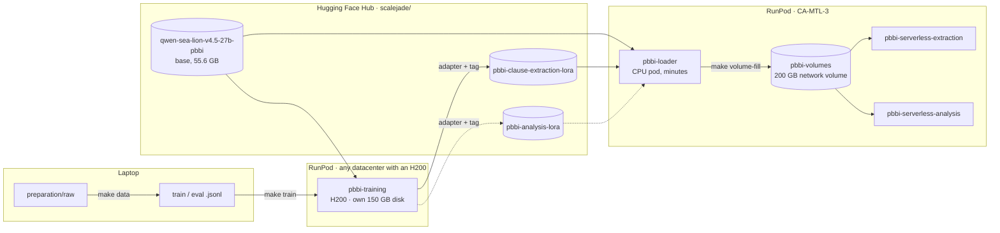

# PBBI

**Perjanjian Baku Bank Indonesia.** The app (`scalejade/perjanjian-baku-bi`) reads
standard-form agreements of payment service providers (PJP) — terms and
conditions, privacy policies, user agreements — and Bank Indonesia's legal team
assesses each clause for compliance. This project fine-tunes and serves the models
behind it: one base model, one LoRA adapter per task.

| Task                 | What the model does                                                               | Config                                    | Endpoint                       | State                                    |
| -------------------- | --------------------------------------------------------------------------------- | ----------------------------------------- | ------------------------------ | ---------------------------------------- |
| **Extraction** | splits a document into clauses, verbatim, in the app's JSON format                | `training/configs/pbbi-extraction.yaml` | `pbbi-serverless-extraction` | adapter`v0.1.0` trained (demo, 3 rows) |
| **Analysis**   | not defined yet — its prompt, data and scoring are the TODOs in the draft config | `training/configs/pbbi-analysis.yaml`   | `pbbi-serverless-analysis`   | draft — no data or adapter yet          |

How it is trained and served on RunPod, what each piece costs, and what to do when
it breaks. Written 2026-10-13 from a real end-to-end training run on 2026-10-12;
numbers marked *measured* come from that run.

| Page                                    | For                                                                     |
| --------------------------------------- | ----------------------------------------------------------------------- |
| [README](README.md) (this page)          | the project, and the map: every component, where it runs, what it costs |
| [training.md](training.md)               | running a fine-tune, start to finish                                    |
| [serving.md](serving.md)                 | the network volume, the loader, the two endpoints                       |
| [evaluation.md](evaluation.md)           | `pbbi-eval`, how a reply is scored, and every adapter's results          |
| [troubleshooting.md](troubleshooting.md) | every failure we have hit, and its fix                                  |
| [reports/](reports/)                     | dated evaluation reports (md, csv, pdf): [v0.1.2 vs gpt-4.1-mini](reports/pbbi-extraction-eval-v0.1.2-vs-gpt-4.1-mini.md), [v0.1.3 vs v0.1.2](reports/pbbi-extraction-eval-v0.1.3.md), 2026-10-17 |

## Where PBBI lives in this repo

| Path                                    | What                                                                                                                    |
| --------------------------------------- | ----------------------------------------------------------------------------------------------------------------------- |
| `preparation/`                        | training data built from Legal's labelled documents, in the exact request the app sends — see`preparation/README.md` |
| `training/configs/pbbi-*.yaml`        | one config per task; the config is the experiment record                                                                |
| `models/qwen-sea-lion-v4.5-27b-pbbi/` | the base model's card and vLLM engine config                                                                            |
| `runpod/pbbi-*/`                      | every RunPod resource, one chart each: training pod, volume, loader, two endpoints                                      |
| `registry/`                           | what is on the Hub (`models.yaml`) and what is deployed (`deployments.yaml`)                                        |
| `docs/pbbi/`                          | this documentation                                                                                                      |

## The idea in one paragraph

Training and serving are deliberately **decoupled**. Training rents an H200 on its
own disk, in whatever datacenter has one free, and its only output is a LoRA
adapter pushed to the Hugging Face Hub. Serving lives in one fixed datacenter on a
network volume that a cheap CPU pod fills ahead of time, so a serverless worker
never downloads 55 GB on a cold start. The Hub is the only thing the two sides
share.

Dashed lines are planned: the analysis model has no data or config yet.

## Components

| Name                           | Kind                | Where                       | Hardware                            | Tool                                                           | Lives                   |
| ------------------------------ | ------------------- | --------------------------- | ----------------------------------- | -------------------------------------------------------------- | ----------------------- |
| `pbbi-training`              | pod                 | any datacenter with an H200 | 1× H200 141 GB, 150 GB own disk    | `make pod-up/train/pod-delete` (`training/scripts/pod.py`) | one training run        |
| `pbbi-volumes`               | network volume      | CA-MTL-3                    | 200 GB                              | `runpod/deploy.py`                                           | permanent               |
| `pbbi-loader`                | pod (CPU)           | CA-MTL-3, on the volume     | `cpu3c`/`cpu5c`, 4 vCPU         | `make volume-fill`                                           | minutes, deletes itself |
| `pbbi-serverless-extraction` | serverless endpoint | CA-MTL-3, on the volume     | RTX PRO 6000 Blackwell Server 96 GB | `runpod/deploy.py`                                           | permanent, scales to 0  |
| `pbbi-serverless-analysis`   | serverless endpoint | CA-MTL-3, on the volume     | same                                | `runpod/deploy.py`                                           | permanent, scales to 0  |
| `pbbi-eval`                  | pod (vLLM)          | any datacenter with a free GPU | H100 / H100 NVL / H200 / RTX PRO 6000, own 100 GB disk | `runpod/deploy.py` | one evaluation, then deleted |

Every component is a **chart**: a directory under `runpod/` holding `chart.yaml`
(identity, dependencies) and `values.yaml` (configuration, field names 1:1 with the
RunPod REST API). Nothing is created by clicking in the RunPod console: a resource
made there exists nowhere in git.

> **Two endpoints, two charts.** `runpod/pbbi-serverless-extraction/` and
> `runpod/pbbi-serverless-analysis/` are the same chart shape, differing only in
> `adapter:` and their `.env`. Each deploys as its own RunPod template + endpoint,
> named after its directory. (The extraction chart was `pbbi-serverles` until
> 2026-10-13.)

## Models on the Hub

| Repo                                      | What                                                   | Pinned at                                                        |
| ----------------------------------------- | ------------------------------------------------------ | ---------------------------------------------------------------- |
| `scalejade/qwen-sea-lion-v4.5-27b-pbbi` | base for both tasks (Qwen3.5 27B, dedicated PBBI copy) | `8d32a4b9c89c9272ae8d660792182da7950955a2`                     |
| `scalejade/pbbi-clause-extraction-lora` | extraction LoRA, r=16, 319 MB                          | `stable` = `v0.1.3` → `63773a48` (test F1 0.716, [report](reports/pbbi-extraction-eval-v0.1.3.md)) |
| `scalejade/pbbi-analysis-lora`          | analysis LoRA                                          | not trained —`training/configs/pbbi-analysis.yaml` is a draft |

Both adapters sit on the **same base**, so one copy of the 55.6 GB base on the
volume serves both endpoints; each endpoint adds only its ~0.3 GB adapter.

## Where things run, and why there

| Datacenter                   | Network volumes | REST API accepts it                             | H200               | RTX PRO 6000 Server  | Verdict                      |
| ---------------------------- | --------------- | ----------------------------------------------- | ------------------ | -------------------- | ---------------------------- |
| **CA-MTL-3**           | yes             | yes                                             | listed             | **in stock**   | **serving lives here** |
| US-CA-2                      | yes             | yes                                             | sold out on create | listed, not in stock | fallback for serving         |
| EU-FR-1                      | yes             | yes                                             | in stock           | **absent**     | cannot serve                 |
| US-CO-1                      | yes             | **no** (400 on POST /pods and /endpoints) | –                 | –                   | unusable through the API     |
| US-GA-2, US-NC-1, EUR-IS-4/5 | **no**    | yes                                             | in stock           | –                   | training only (own disk)     |

Checked 2026-10-12/13. Stock changes by the hour: `make pod-gpus` for prices, and
the GraphQL query in [troubleshooting.md](troubleshooting.md#no-instances-available)
for stock per datacenter.

## Costs

| Item                             | Rate                              | Billed when                                        |
| -------------------------------- | --------------------------------- | -------------------------------------------------- |
| H200 training pod                | $5.29/hr (Secure)                 | from`pod-up` until `pod-delete` — idle or not |
| Training pod's own disk, stopped | $0.20/GB/mo → ~$1/day for 150 GB | after`pod-stop`, until `pod-delete`            |
| `pbbi-volumes`                 | $0.07/GB/mo → ~$14/mo for 200 GB | always, from`apply` until `delete`             |
| `pbbi-loader`                  | cents per hour                    | a few minutes per`make volume-fill`              |
| Serverless worker                | per second while a worker is up   | only when requests arrive (`workersMin: 0`)      |

*Measured* for one training run: the 3-document demo took ~80 min of pod time,
**~$7**. A 60-document run is estimated at **3–4 h, ~$16–21** (see
[training.md](training.md#how-long-a-run-takes)).

## Secrets

Each chart has its own gitignored `runpod/<chart>/.env` (template:
`.env.example` beside it), and its `${VAR}`s resolve from that file only.

| File                                                                                 | Holds                                                                                | Leaves the laptop?                                           |
| ------------------------------------------------------------------------------------ | ------------------------------------------------------------------------------------ | ------------------------------------------------------------ |
| `.env` (repo root)                                                                 | `RUNPOD_API_KEY`, the laptop's `HF_TOKEN`                                        | **never** — the RunPod key controls the whole account |
| `runpod/pbbi-training/.env`                                                        | `HF_TOKEN` (write), `SSH_PUBLIC_KEY`, `WANDB_API_KEY`, `BOOT_MODEL/REVISION` | into the training pod's env                                  |
| `runpod/pbbi-loader/.env`                                                          | `HF_TOKEN` (read), `SSH_PUBLIC_KEY`, `BOOT_MODEL/REVISION`, `BOOT_ADAPTERS`  | into the loader pod's env                                    |
| `runpod/pbbi-serverless-extraction/.env`, `runpod/pbbi-serverless-analysis/.env` | `HF_TOKEN` (read), `MODEL`, `ADAPTER_REVISION`                                 | into that endpoint's template env                            |

**Never copy a `.env` onto a pod.** It happened on 2026-10-12 and put the account-wide
RunPod key on a shared volume (and broke training — see troubleshooting).

## State on 2026-10-16

- **Adapter `v0.1.0` works**: served by vLLM 0.30 on `pbbi-eval`, it lifts validation
  recall 0.405 → 0.690 and precision 0.596 → 0.806 over the base
  ([evaluation.md](evaluation.md#results)). It is a demo model (3 training rows).
- **Live on RunPod:** only `pbbi-volumes` (CA-MTL-3, ~$14/mo) — empty: the loader could
  not get a CPU there. No pods, no endpoints. Template `pbbi-serverless-extraction`
  is kept for reuse (free).
- **Serverless has not answered a request yet** — every attempt hit GPU capacity in the
  volume's datacenter, not a configuration error. What is and is not verified:
  [serving.md](serving.md#verified-and-not-yet).
- `registry/deployments.yaml` still lists `pjp-clause-extraction` as `active`. It is
  not; that entry is stale and should be retired in a PR.
